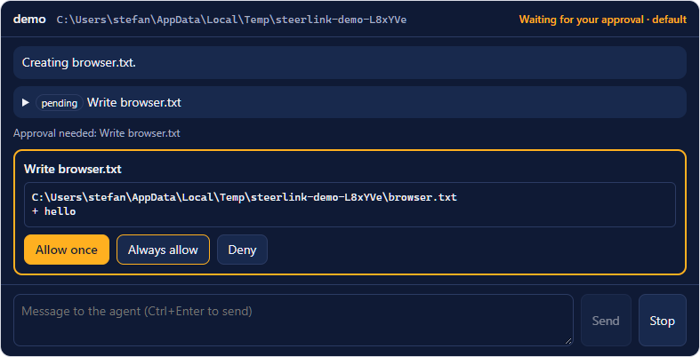

# SteerLink

Steer and remote-control **Claude Code** from **Grok Bot**. SteerLink is an MCP server that lets an MCP host
such as Grok Bot or Cursor delegate coding work to [ACP](https://agentclientprotocol.com) coding agents — Claude Code
by default, plus any other ACP agent such as Codex. The host starts a session in a project, sends a task, and approves
or denies every change the agent wants to make, with the diff in front of it.

```
MCP host (Grok Bot, Cursor, …) ──MCP/stdio──▶ steerlink ──ACP/stdio──▶ claude-agent-acp (Claude Code)
                                                               └─ACP/stdio──▶ other ACP agents (e.g. codex-acp)
```

**Product page:** <https://foxkill.github.io/steerlink/> (source in `site/`, published by
`.github/workflows/pages.yml`).

The bridge plays the role an editor such as Zed plays for its external agents: it is the ACP client. The agents run
unmodified through their official ACP adapters.

> Claude Code is a product of Anthropic. Codex is a product of OpenAI. This project is independent and not
> affiliated with or endorsed by Anthropic, OpenAI or xAI.

## Install as a plugin

The repository is a plugin in the Cursor plugin format, which Grok Bot uses as well:

| File | Content |
|---|---|
| `.cursor-plugin/plugin.json` | Manifest, declares the variable `ANTHROPIC_API_KEY` |
| `mcp.json` | Starts the server with `npx -y steerlink@<version>` |
| `skills/delegate-to-coding-agent/SKILL.md` | Tells the host's agent how to use the tools and to ask you before every change |

After installing the plugin, set **`ANTHROPIC_API_KEY`** in the plugin settings to your own key from the
[Claude Console](https://platform.claude.com/). Usage is billed directly to your Anthropic account; the bridge never
stores, logs or transmits the key anywhere except to the agent process it starts.

The first start downloads the package and its dependencies (about 300 MB, most of it the native Claude Code binary
that ships with Anthropic's Agent SDK). If your host aborts that first start with a timeout, start it once more after
the download has finished.

## Use it as a plain MCP server

Any MCP host that runs stdio servers can use the bridge directly (Node.js ≥ 20.19):

```json
{
  "mcpServers": {
    "steerlink": {
      "command": "npx",
      "args": ["-y", "steerlink@0.1.12"],
      "env": { "ANTHROPIC_API_KEY": "<your Anthropic API key>" }
    }
  }
}
```

The server runs on the machine of the host — for Grok Bot that is *Grok Bot's computer*, so project paths refer to
that machine.

## Talk to it

You do not call the tools yourself. Tell the bot in plain words, in any language, and it picks the tool:

| You want to | Say to the bot | Tool it calls |
|---|---|---|
| See the agents | "List the steerlink agents" | `list_agents` |
| Check the sign-in | "steerlink auth status" | `auth_status` |
| See running sessions | "Which steerlink sessions are running?" | `list_sessions` |
| See open approvals | "Any pending permissions?" | `list_pending_permissions` |
| Stop the agent | "Cancel the Claude Code session" | `cancel` |
| Talk to Claude Code directly | "Direct mode: pass my messages to Claude Code unchanged" | `send_prompt`, answers shown verbatim |
| Finish | "Close the session" | `close_session` |

A full task in one message:

> Let Claude Code add input validation to the signup form in `/home/box/code/shop`, run the tests at the end, and
> ask me before every change.

The plugin ships no slash commands such as `/list-agents`; Grok Bot hides slash commands by default. Claude Code's own
slash commands (for example `/compact`) can be sent as a prompt; `start_session` lists which ones a session accepts.

For regular coding work, set up a dedicated bot: see [docs/grok-bot-instructions.md](docs/grok-bot-instructions.md)
for ready-to-paste instructions, including a GitLab issue workflow and short commands such as `sl status`,
`sl allow` or `sl issue 42`.

## Tools

| Tool | Purpose |
|---|---|
| `list_agents` | Configured agents with status and auth methods |
| `start_session` | `cwd` (absolute), optional `agent` and `mode` (default `default`: every change needs approval; also `acceptEdits`, `plan`, `auto`, `bypassPermissions`). Returns the modes and `available_commands`, the slash commands the session accepts. |
| `send_prompt` | `session_id`, `text`, `wait` (default `true`), `timeout_seconds` (default 100, below the two minutes after which hosts such as Grok Bot give up). Returns status, response text, tool calls with diffs and pending permissions. `wait=false` only starts the turn. |
| `get_session_updates` | Events since the last call (text, tool calls, diffs, plans, permissions, end of turn); `wait_seconds` long-polls |
| `list_pending_permissions` | Pending permission requests with tool, input, diff and options |
| `respond_permission` | `permission_id` plus `decision` (`allow`, `allow_always`, `deny`, `deny_always`) or a specific `option_id` |
| `set_mode` | Change the session mode |
| `cancel` | Cancel the running turn and withdraw pending permissions |
| `close_session` / `list_sessions` | Manage sessions; `list_sessions` also shows each session's slash commands |
| `auth_status` | Active sign-in method without secrets; `restart_agent=true` after changing credentials |
| `authenticate` | Run an auth method offered by the agent; terminal methods only return the command |

Typical flow:

1. `start_session { cwd: "/path/to/project" }`
2. `send_prompt { session_id, text: "…" }` → `status`
   - `awaiting_permission`: review `pending_permissions` (diff!), then `respond_permission { permission_id, decision }`
   - `running`: repeat `get_session_updates { session_id, wait_seconds: 30 }`
   - `idle`: the turn is done; read `response_text` and `tool_calls`
3. Long tasks: `send_prompt { …, wait: false }` and poll.

While `send_prompt` or `get_session_updates` waits, SteerLink reports progress every 10 seconds to hosts that ask for
it (a `progressToken`), so such hosts keep waiting instead of aborting the call. Hosts that do not ask for progress get
at most 100 seconds per call, whatever `timeout_seconds` or `wait_seconds` says, so the call ends before hosts such as
Grok Bot give up after two minutes; the result then has `status: running`, and the next call continues.

## Session view in the chat

In hosts that render [MCP Apps](https://github.com/modelcontextprotocol/ext-apps) (for example Claude, ChatGPT and
VS Code), SteerLink also offers `show_session`. It opens a live view of the session right in the chat: the agent's
messages, every change with its diff, and **Allow once / Always allow / Deny** buttons. You can also type to the agent
and stop it there.



- A click in the view is your own answer: the view's tools are hidden from the model, so it also counts in
  `permission_prompt=required` mode.
- The view is one self-contained HTML document; it loads nothing from the internet, and everything from the agent is
  shown as text.
- Hosts without MCP Apps (Grok Bot at the moment) do not see `show_session` and work as before.
- `ACP_CONNECTOR_SESSION_VIEW` (plugin setting *Session view*): `auto` (default) offers the view only where the host
  declares MCP Apps; `on` offers it anyway, to try whether a host such as Grok Bot renders it; `off` never offers it.
  With `on` and no declared support the host may also show the view's tools to its model, so a click in the view
  counts as the host's answer: it does not satisfy `permission_prompt=required`. `auth_status` reports this as
  `session_view_forced: true`.
- Try it locally without any host: `npm run view:host` (a demo agent, nothing is billed) or
  `npm run view:host -- --claude` (real Claude Code with your own sign-in), then open http://127.0.0.1:5173/.

## Permission dialogs

If the MCP host can show forms (MCP *elicitation*), SteerLink asks **you** directly whenever the agent wants to change
a file or run a command. The dialog shows the request with a preview and the choices *Allow once*, *Always allow*,
*Deny*. Your answer goes straight to the agent, and the host's model only sees the result. If you dismiss or decline
the dialog, or the host cannot show one, the host asks you in the chat as before. Some hosts declare dialog support
but decline every dialog at once; SteerLink notices that and switches dialogs off for that host.

| `ACP_CONNECTOR_PERMISSION_PROMPT` | Behaviour |
|---|---|
| `auto` (default) | Dialog if the host supports it; the host's model may still answer |
| `required` | Only you can **allow** anything, in the dialog or in the session view; the host's model can only deny. Sessions refuse to start if the host has neither. Use it so that no text in a prompt, issue or file can make the model approve changes. |
| `off` | No dialogs; the host's model answers via `respond_permission` |

`auth_status` reports `permission_prompt: { mode, user_dialog, session_view, session_view_forced, note }`, so you can check what your host
supports. Its `host` field shows the host's name, version and the capabilities it declared on connect, unchanged
(MCP Apps appear under `capabilities.extensions["io.modelcontextprotocol/ui"]`). With `ACP_CONNECTOR_DEBUG=1` the same
goes to stderr. Its `server` field shows SteerLink's own name and version and the Node.js version it runs on, so an
outdated install on the host's computer shows at a glance.

## Authentication and billing

| `ACP_CONNECTOR_AUTH_MODE` | Behaviour |
|---|---|
| `api_key` (default, used by the plugin) | `ANTHROPIC_API_KEY` is required. Subscription credentials (`CLAUDE_CODE_OAUTH_TOKEN`) are removed from the agent's environment, so the key pays. Claude Code's built-in sign-in methods stay available, as Anthropic requires. |
| `subscription` (personal use only, opt-in) | API keys are removed from the agent's environment so that your own existing Claude Code login (`claude /login`) applies. The bridge never reads, stores or forwards the subscription token. |

Every user signs in with their own credentials; the bridge does not resell or intermediate Claude usage. See
Anthropic's [legal and compliance notes for Claude Code](https://code.claude.com/docs/en/legal-and-compliance).

Unset plugin variables arrive as literal placeholders such as `${ANTHROPIC_API_KEY}`; the bridge treats them as
missing and says so in `auth_status` instead of passing them on. An empty value switches a credential off: for
example, `CLAUDE_CODE_OAUTH_TOKEN=""` in the server's env overrides a global token, so Claude Code uses its stored
claude.ai login (needed for Remote Control, which a `claude setup-token` token does not cover).

`auth_status` shows *whether* credentials are present and the kind of identity the agent reports (for example
`api_key`), never e-mail addresses, organisations or tokens. Variables of a surrounding Claude Code session
(`CLAUDECODE`, `CLAUDE_CODE_*` except `CLAUDE_CODE_OAUTH_TOKEN`) are not inherited by the agent.

## More agents

Optional JSON file, path in `ACP_CONNECTOR_CONFIG` (modelled on Zed's `agent_servers`):

```json
{
  "default_agent": "claude",
  "auth_mode": "api_key",
  "agent_servers": {
    "codex": {
      "type": "custom",
      "command": "npx",
      "args": ["-y", "@zed-industries/codex-acp"],
      "env": {}
    }
  }
}
```

- `claude` is built in (the bundled `claude-agent-acp`); an entry named `claude` replaces it.
- `auth_profile`: `"claude"` applies the rules above (default for the name `claude`); `"none"` passes env and
  args through unchanged. Each agent's own terms apply to its use.
- `permission_prompt` sets the dialog mode (see *Permission dialogs*), `session_view` when the session view is offered
  (see *Session view in the chat*).
- Environment overrides: `ACP_CONNECTOR_AUTH_MODE`, `ACP_CONNECTOR_DEFAULT_AGENT`,
  `ACP_CONNECTOR_PERMISSION_PROMPT`, `ACP_CONNECTOR_SESSION_VIEW`. `ACP_CONNECTOR_DEBUG=1` mirrors
  the agents' stderr (may contain account details — for debugging only).

## Development

```bash
npm ci
npm run check           # typecheck, lint, format check, unit and integration tests, plugin validation
npm run lint:fix        # oxlint with type-aware rules, safe fixes
npm run format          # oxfmt, 4-space indentation
npm run test:package    # npm pack → install into an empty folder → start via npx (needs network)
npm run test:smoke      # against the real claude-agent-acp (needs ANTHROPIC_API_KEY)
npm run demo            # end-to-end demo: MCP client → bridge → Claude Code → hello.txt
npm run test:view       # the session view in headless Chrome: approve with a click, file is written
npm run view:host       # local MCP Apps host for the session view at http://127.0.0.1:5173/
```

Tooling: TypeScript 7 with the strictest compiler options (`noUncheckedIndexedAccess`, `exactOptionalPropertyTypes`,
`verbatimModuleSyntax`, …), [oxlint](https://oxc.rs) with type-aware rules via `oxlint-tsgolint`, and oxfmt.
`tsconfig.json` covers the whole project for the editor, the type checker and the linter; `tsconfig.build.json` builds
only `src/`. The session view lives in `ui/` (browser code, its own `ui/tsconfig.json` with DOM types); esbuild bundles
it with the official [MCP Apps SDK](https://github.com/modelcontextprotocol/ext-apps) into one HTML file
(`dist/ui/session-view.html`). External JSON (config file, `package.json`) is validated with zod instead of type assertions.

Before submitting to a marketplace, test locally and in-app as described in
[docs/testing-in-grok-bot.md](docs/testing-in-grok-bot.md) (`npm run plugin:local` for Cursor, a `next` prerelease for
Grok Bot).

`npm test` runs offline against a fake ACP agent and costs nothing. `npm run validate:plugin` checks the plugin
against Cursor's submission checklist and against this repository (pinned version in `mcp.json` = `package.json`,
declared variables, logo, skills, no secrets).

```
src/main.ts                     stdio entry point
src/package-info.ts             name and version from package.json
src/config/                     agent_servers, auth_mode, environment handling
src/auth/agent-launch.ts        env/args per auth mode (never touches secret values)
src/acp/agent-process.ts        agent subprocess and ACP client connection
src/sessions/                   sessions, event buffer, permissions
src/mcp/mcp-server.ts           MCP tools
.cursor-plugin/, mcp.json,      plugin
skills/, assets/
scripts/validate-plugin.ts      plugin validator
test/                           tests (fake ACP agent in test/fixtures)
test/e2e/                       package and smoke tests
```

## Support

SteerLink is free and open source. If it saves you time, you can support its development with a donation via
[PayPal](https://paypal.me/foxkilldev). Donations are voluntary; they do not buy access, support guarantees or Claude
usage.

## License

[MIT](LICENSE) © 2026 Stefan Martin
